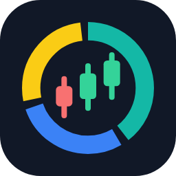
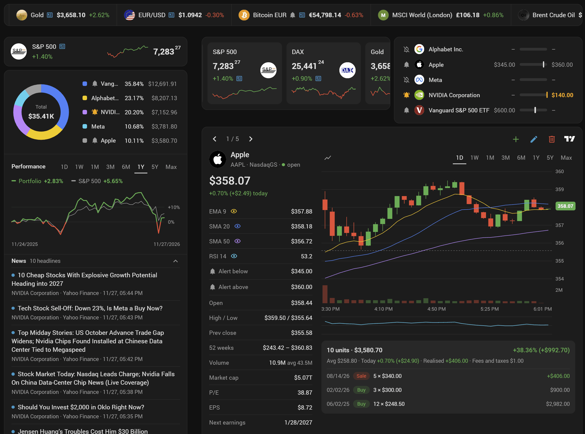
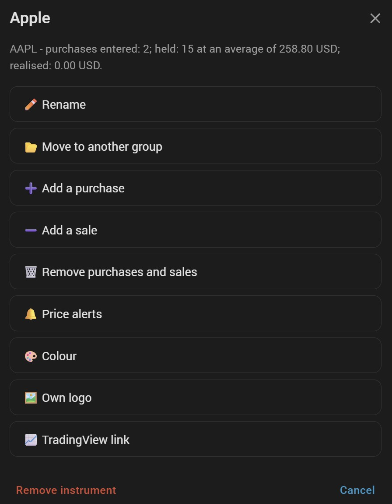
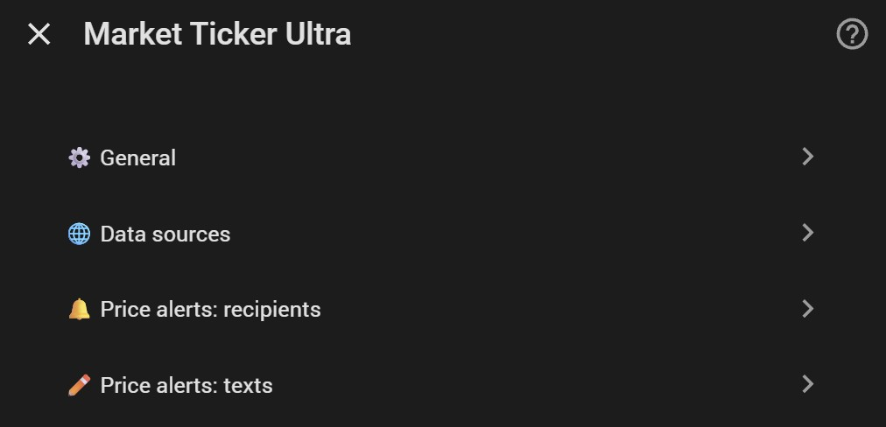
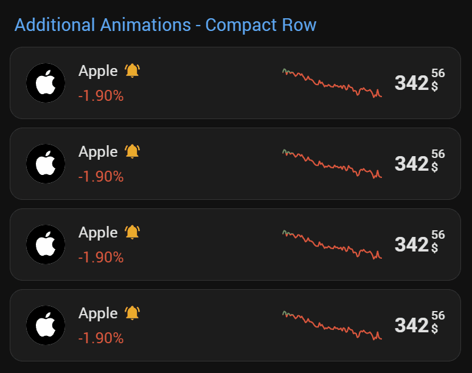
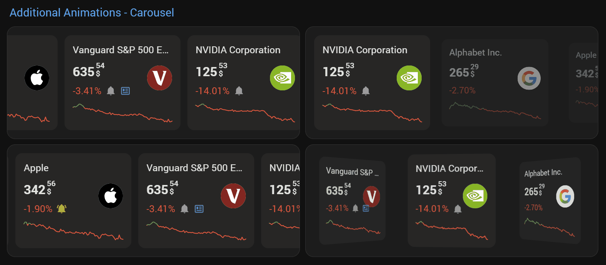
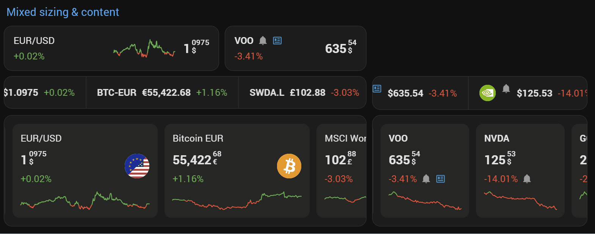
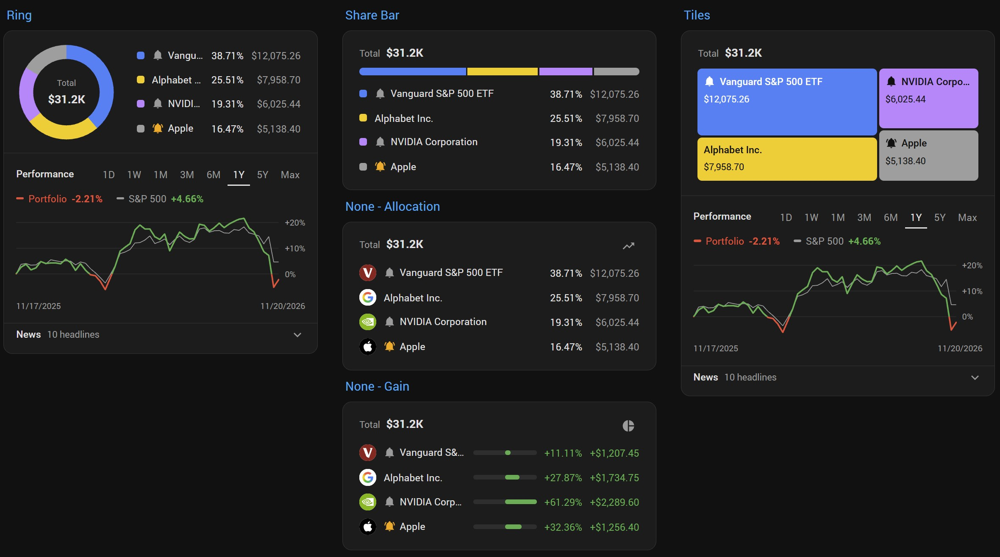
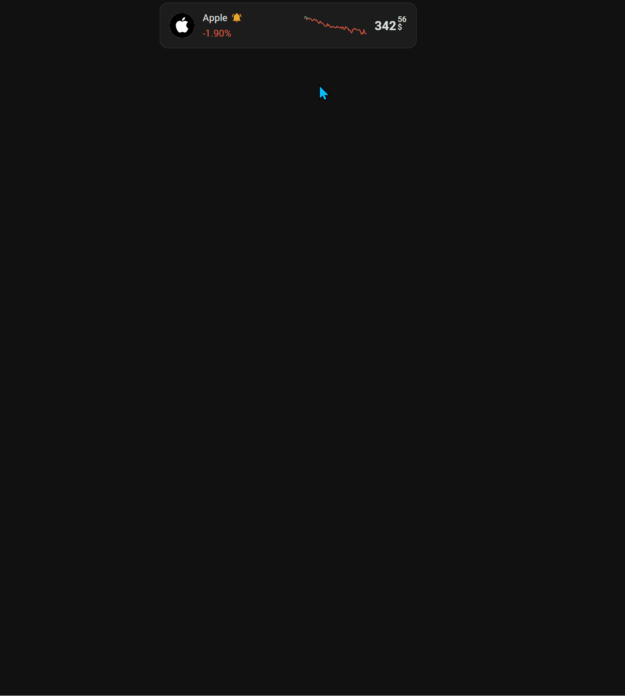
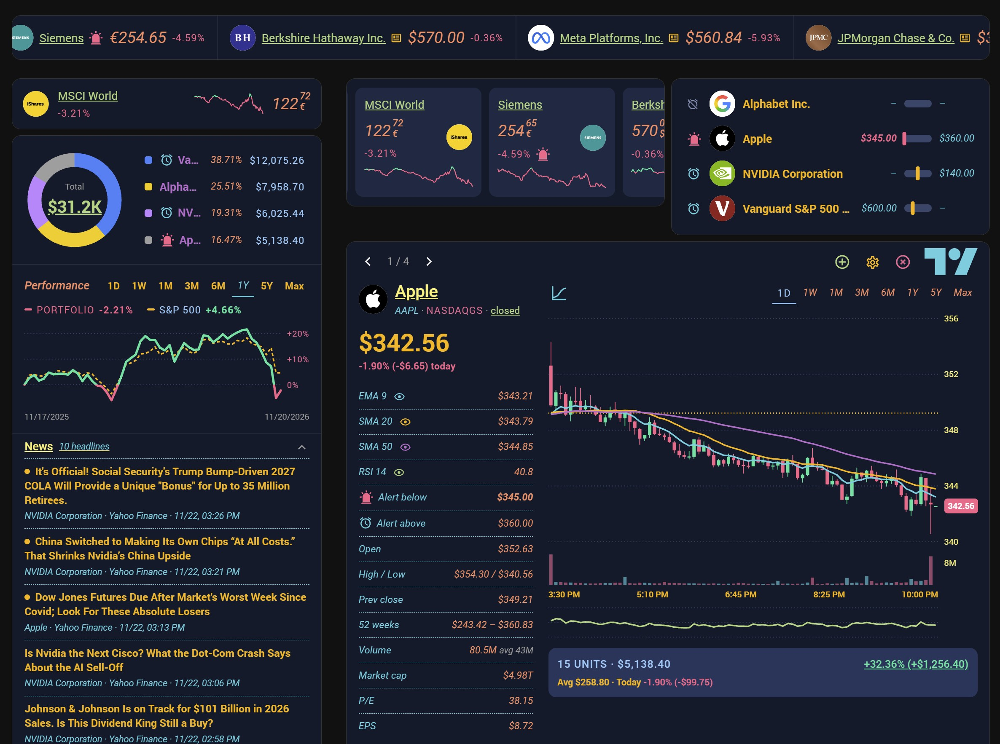

#  Market Ticker Ultra for Home Assistant - live quotes, portfolios and news, no account, no API key

[](https://my.home-assistant.io/redirect/marketplace_repository/?owner=somansch&repository=market_ticker_ultra&category=Integration)
[](https://www.home-assistant.io/)
[](https://github.com/somansch/market_ticker_ultra/blob/main/LICENSE)
[](https://github.com/somansch/market_ticker_ultra/releases)
[](https://github.com/somansch/market_ticker_ultra/releases/latest)
[](https://github.com/somansch/market_ticker_ultra/releases/latest)
[](https://buymeacoffee.com/ou4lgpvlju)

**Available languages:** English, Deutsch, Français, Nederlands, Polski, Español, Italiano, Português (Brasil), Русский, Svenska, 简体中文, Čeština, Norsk bokmål, Dansk, Türkçe, Slovenčina, Lietuvių, Suomi, 日本語



## Overview

Most ways of getting share prices into Home Assistant start with an account somewhere and an API key to paste, a daily request limit to stay under, and one sensor per symbol that still has to be turned into something worth looking at. Market Ticker Ultra asks public sources instead - Yahoo Finance, Börse Frankfurt, the European Central Bank, Kraken and gold-api.com - and brings its own dashboard card, so a portfolio is on the wall in a few minutes.

Typical reasons to use it:
- **See the markets at a glance** - a running ticker, a compact row, a carousel of tiles or one instrument's full details, with six [animations](#animations) to move from one instrument to the next.
- **Watch any kind of instrument** - stocks, funds, ETFs, indices, futures, currency pairs, coins and precious metals, found by name, symbol or ISIN ([Adding an instrument](#adding-an-instrument)).
- **Keep track of what you own** - enter your purchases and sales, and every position gets its value and gain as sensors, with what sales have realised and what was paid in fees and taxes ([Purchases and sales](#purchases-and-sales)).
- **Several portfolios and watchlists** - group your instruments the way your brokers do, each portfolio added up in one base currency and compared with an index of your choice, such as the S&P 500 ([Groups](#groups-portfolios-and-watchlists)).
- **Get told when a price is reached** - [price alerts](#price-alerts) as binary sensors, announced through your phone, a messenger, a mail service or read out on a Sonos speaker, with texts you write yourself.
- **Read the news about what you hold** - the newest headlines for each instrument and for a whole portfolio, with the ones you have not seen yet counted and marked ([News](#news)).
- **Know when the next quarterly figures are due** - the earnings date in the details, marked where it is only an estimate.
- **Everything from the card** - add, change and remove instruments, enter a purchase or set an alert without leaving the dashboard ([Live editing](#live-editing)).
- **Make the card your own without YAML** - the same visual editor as the [Annuals](https://github.com/somansch/annuals) and [TomTom](https://github.com/somansch/tomtom) cards: every colour, font, symbol and background is set in the interface, no YAML and no card-mod required ([The visual editor](#the-visual-editor)).

**Architecture note:** a portfolio or watchlist is a config entry, and every instrument in it is a sub-entry of that entry - the same pattern Home Assistant uses for its own integrations with sub-items. Each instrument is its own device with its own sensors, found through the search on **Settings → Devices & Services**, and edited from its own menu there.

## Quick start

1. **Install** via [Marketplace (HACS)](#marketplace-hacs) (or [manually](#manual)), then restart Home Assistant.
2. **Settings → Devices & Services → Add Integration → "Market Ticker Ultra"** - this sets up the shared settings: update interval, base currency, logos and sources ([First-time setup](#first-time-setup)). A first portfolio and a first watchlist are created with it.
3. On the integration's page, click **Add instrument** on a portfolio or a watchlist, search for it, pick the listing, and enter what you hold - or nothing, to only watch it ([Adding an instrument](#adding-an-instrument)).
4. Add the [dashboard card](#dashboard-card) - search for "Market Ticker Ultra" in the card picker, or pick one of the integration's entities and take one of the cards suggested for it.
5. Want to be told when a price is reached? Set a [price alert](#price-alerts) on the instrument and choose the recipients in the [settings](#settings).

That's the whole setup - everything below covers the individual features and options in more depth.

## Quick links

**Setting up**

- [First-time setup](#first-time-setup)
- [Groups: portfolios and watchlists](#groups-portfolios-and-watchlists)
- [Adding an instrument](#adding-an-instrument)
- [Changing an instrument](#changing-an-instrument)
  - [Purchases and sales](#purchases-and-sales) - from a watchlist into a portfolio and back
  - [Own logo, colour and TradingView link](#own-logo-colour-and-tradingview-link)
- [Settings](#settings)

**How it works**

- [Data sources](#data-sources) - which source quotes what, and what happens when one does not answer
- [Currencies and performance](#currencies-and-performance)
- [Price alerts](#price-alerts) - recipients, texts and the event for automations
- [News](#news) - and the next earnings date
- [Created entities](#created-entities) - every sensor attribute, for your own templates

**Showing it on a dashboard**

- [Dashboard card](#dashboard-card)
  - [Formats](#formats)
  - [Animations](#animations)
  - [Card size](#card-size)
  - [The portfolio format](#the-portfolio-format)
  - [The price alerts format](#the-price-alerts-format)
  - [Details and the pop-up](#details-and-the-pop-up)
  - [Live editing](#live-editing)
  - [The visual editor](#the-visual-editor)
  - [Making it your own](#making-it-your-own)

**Installing**

- [Installation](#installation)
- [Disclaimer](#disclaimer)
- [Help and Contribution](#help-and-contribution)

## First-time setup

The first time you go to **Settings → Devices & Services → Add Integration → "Market Ticker Ultra"**, it asks for the settings every group shares:

| Setting | What it does |
|---|---|
| **Update interval** | How often the quotes are fetched while a market is open - 5 minutes unless you say otherwise, 1 to 120. While all markets are closed, they are fetched every 30 minutes at most. |
| **Base currency** | The currency all positions are added up in, as a three-letter code - USD, EUR, CHF. |
| **Logos** | Each instrument with its logo on the card. Switched off, the card shows initials - and your [own logos](#own-logo-colour-and-tradingview-link). |
| **Sources** | Where quotes may come from - see [Data sources](#data-sources). At least one is needed. |

That creates the **"⚙ Settings"** entry, together with a first portfolio and a first watchlist. Everything here can be changed later, under [Settings](#settings).

## Groups: portfolios and watchlists

Every instrument belongs to a group, and a group is one of two kinds:

- A **portfolio** adds up what is held. Its instruments get position sensors, and the portfolio gets a value and a gain of its own.
- A **watchlist** is only watched. Purchases entered on an instrument in a watchlist are kept with it, but they count in no sum.

Add another group with **Add group** on the integration's page - a name, the kind, and for a portfolio the **Index to compare with**: the index its [performance](#currencies-and-performance) is set beside on the card. Choose one from the list, or type any symbol of Yahoo Finance, such as `^GSPC` for the S&P 500 or `^IXIC` for the Nasdaq Composite. **Configure** on the group changes all three later; turning a portfolio into a watchlist takes its sums away again.

## Adding an instrument

Click **Add instrument** on the group it belongs in.

1. **Find an instrument** - search by name, by symbol or by ISIN: *Apple*, *AAPL*, *US0378331005*, *S&P 500*, *EUR/USD*, *BTC*, *gold*. Every source that is switched on is asked at once.
2. **Choose the listing** - the same instrument is often listed at several exchanges and sources, in different currencies. Each line ends with the last price there and where it is from; a date behind a price means it is not from today.
3. **Your holding** - the quantity, the purchase price per unit and, optionally, the date, fees and taxes. Leave it all empty to only watch the instrument.

## Changing an instrument

Each instrument has its own menu: **Settings → Devices & Services → Market Ticker Ultra**, the three dots on the instrument, **Reconfigure** - or the pencil on the [card](#live-editing). The menu's heading sums up what is held:



| Entry | What it does |
|---|---|
| ✏️ **Rename** | The name its device and sensors are called. |
| 📂 **Move to another group** | Into another portfolio or watchlist. Its sensors stay the same. |
| ➕ **Add a purchase** | One more purchase - see below. |
| ➖ **Add a sale** | A sale. Offered while something is held. |
| 🗑️ **Remove purchases and sales** | Tick what should go. Removing all of them leaves an instrument that is only watched. |
| 🔔 **Price alerts** | A lower and an upper limit - see [Price alerts](#price-alerts). |
| 🎨 **Colour**, 🖼️ **Own logo**, 📈 **TradingView link** | See [below](#own-logo-colour-and-tradingview-link). |

### Purchases and sales

A purchase and a sale both take a quantity above zero, a price per unit and, optionally, a date, fees and taxes. **Add another one after this** opens the same form again, for several at once.

- **A sale** leaves the holding at the average price paid until then, and what it brought in above that average is the **realised gain**. A sale of more than is held is refused. Its date is today unless you enter another.
- **The date** decides the order in which purchases and sales are counted: a sale only takes from what was bought before it. A purchase without a date counts first.
- **A purchase on a watchlist** moves the instrument into a portfolio - one you have, or a new one created on the spot, the first or one more. Its sensors stay the same.
- **Selling everything** asks what happens next: keep the instrument in the portfolio, move it to a watchlist, or remove it. Its purchases and sales go with it in every case, and so does what it has earned.

### Own logo, colour and TradingView link

- **Colour** - the colour the instrument is drawn in where the card shows a portfolio's shares: in the ring, on the share bar and on a tile. Choose one of Home Assistant's colours, or type a value such as `#009999`. Empty, the card picks one.
- **Own logo** - an image of your own, for an instrument without a logo or in place of the one it has: PNG, JPG, WebP, GIF or SVG, up to 1 MB, a square one fits best. It is kept in your configuration folder, under `market_ticker_ultra/logos`, and shown with the logos switched off too.
- **TradingView link** - the card links an instrument's details to its page at TradingView. The symbol for that is worked out from what the source calls the instrument; the form shows the one in use, and takes your own in TradingView's spelling - the exchange, a colon, the ticker, such as `NASDAQ:AAPL`. Where nothing can be worked out, the card shows no link rather than one to a wrong page.

## Settings

**Configure** on the "⚙ Settings" entry opens a menu of four pages:



| Page | What it holds |
|---|---|
| ⚙️ **General** | Update interval, base currency and logos - as in [First-time setup](#first-time-setup). |
| 🌐 **Data sources** | The sources that may be asked, and **News from Google News too** - see [News](#news). |
| 🔔 **Price alerts: recipients** | Who is told when a price alert comes on - see [Price alerts](#price-alerts). |
| ✏️ **Price alerts: texts** | What an alert says. |

Both alert pages have **Send a test message now**: tick it, save, and everybody named gets a message with the texts as they stand.

## Data sources

| Source | What it is asked for |
|---|---|
| **Yahoo Finance** | Stocks, funds, indices, futures, currencies and coins - and the charts, the key figures, the news and the earnings dates. |
| **Börse Frankfurt** | Xetra and Frankfurt listings, found by ISIN. |
| **ECB reference rates** | Currency pairs, once a day. |
| **Kraken** | Coins. |
| **gold-api.com** | Spot prices of gold, silver, platinum, palladium and copper. |

None of them needs an account or a key. A few things about how they are used:

- **A source that is switched off is not asked.** The search finds nothing there, and an instrument added from it is quoted by another source that lists the same instrument - or keeps its last quote.
- **A source that does not answer** is stood in for the same way, while it lasts: each instrument keeps its last quote, with the time it is from. After three failed polls in a row, a repair under **Settings → Repairs** says which source it is and why. Nothing needs doing - the repair goes away with the source's next answer.
- **Charts and key figures** come from the instrument's own source, or from the one standing in for it. **News and earnings dates** come from Yahoo Finance; for a listing from another source, the instrument is looked up there by its ISIN.
- **Closed markets** are not asked every few minutes for a price that cannot change: while all markets are closed, the quotes are fetched every 30 minutes at most.

## Currencies and performance

**Base currency.** Every position is added up in the base currency from [Settings](#settings). A position in another currency is converted at the European Central Bank's daily reference rate; the portfolio's value sensor says which day's rates it used, and which positions could not be converted. An instrument's own sensors stay in its own currency.

**Performance.** The [portfolio format](#the-portfolio-format) draws the portfolio's return over a period - one day to the whole period - beside the index set for its group. It is a **time-weighted return**: a purchase or a sale in the middle of the period does not count as a gain or a loss, so the line compares how the holdings did, not how much money was put in. An instrument without a price series is left out and named under the chart.

## Price alerts

Each instrument can have a lower limit - **At or below** - and an upper one - **At or above**, set under 🔔 **Price alerts** in its [menu](#changing-an-instrument) or from the card. Leave a field empty for no limit.

- Each limit gets a **binary sensor** that is on while the price stands at or beyond it.
- An alert tells its recipients **once, when it comes on**. It is armed again only after the price has left the limit, so a price hovering at the limit does not send a message on every update.
- Every alert also fires the event **`market_ticker_ultra_alert`**, for your own automations.

### Who is told

**Configure → 🔔 Price alerts: recipients** on the "⚙ Settings" entry:

| Setting | What it does |
|---|---|
| **Notification in Home Assistant** | A notification in Home Assistant itself. On unless you switch it off. |
| **Tell about price alerts** | Notify entities - a phone with the Companion App, for one. |
| **Notify services for price alerts** | Services such as `notify.whatsapp` or `notify.mail`, for messengers and mail. Choose from the list or type a name. |
| **Announce price alerts on** | Speakers the alert is read out on - a Sonos, for example. |
| **Voice for announcements** | The text-to-speech voice the alert is spoken with. Empty takes the first there is. |

One recipient that fails - a speaker switched off, a service gone - does not keep the others from being told; it is noted in the log.

### What it says

**Configure → ✏️ Price alerts: texts** sets the title, the message and the announcement. An empty field takes the default again.

| Variable | Is replaced by | Example |
|---|---|---|
| `{name}` | The instrument's name | Apple |
| `{symbol}` | Its symbol | AAPL |
| `{price}` | The price, with its currency | 344.80 USD |
| `{limit}` | The limit that was reached, with its currency | 345.00 USD |
| `{currency}` | The currency alone | USD |
| `{direction}` | "at or below" or "at or above" | at or below |
| `{change}` | The day's change in percent | -1.90 % |

The defaults read *Price alert* as the title, *{name}: {price} - {direction} {limit}* as the message, and *Price alert. {name} is at {price}, {direction} {limit}.* as the announcement - in English, or in German on a German instance. An index stands in points, so its price and limit have no currency.

### Use in your own automations

The event carries everything about the alert:

| Field | Description |
|---|---|
| `instrument` | The instrument's id. |
| `name`, `symbol` | Its name and symbol. |
| `side` | `below` or `above`. |
| `price`, `limit` | The price and the limit, as numbers. |
| `currency` | The currency, or `null` for an index. |
| `title`, `message` | The texts as they were sent. |

```yaml
automation:
  - alias: "Flash the living room lights on a price alert"
    triggers:
      - trigger: event
        event_type: market_ticker_ultra_alert
        event_data:
          side: below
    actions:
      - action: light.turn_on
        target:
          entity_id: light.living_room
        data:
          flash: short
      - action: notify.mobile_app_phone
        data:
          title: "{{ trigger.event.data.title }}"
          message: "{{ trigger.event.data.message }}"
```

The binary sensors work as triggers too: `binary_sensor.apple_alert_below` turning `on`.

## News

The details of an instrument and the [portfolio format](#the-portfolio-format) show the newest headlines - from Yahoo Finance, and from Google News as well when **News from Google News too** is on (Settings → 🌐 Data sources). Google News is searched for the instrument's name: it finds more headlines, and some that are about something else. A click opens the article in a new tab.

- **In your language.** The headlines are asked for in the language of whoever looks at the card, in that country's edition.
- **New ones are counted.** Headlines you have not seen yet are marked, counted in brackets and shown as a newspaper symbol on the instrument in the ticker, the row and the carousel. What you have seen is kept in Home Assistant for your user, so it is seen in every browser you use, not only in the one you read it in.
- **Compact or open.** Compact shows only the number of headlines until it is clicked. A maximum age hides old ones.
- **An instrument from another source** gets the news of its Yahoo listing, looked up by its ISIN.

**Next earnings.** Among the key figures in the details, **Next earnings** is the day the next quarterly figures are due, from Yahoo Finance - marked *estimated* where Yahoo only estimates it.

## Created entities

Every instrument is its own device, named after the instrument, in the group it belongs to. The sums sit on one device, "Market Ticker Ultra", of the "⚙ Settings" entry.

| Entity | Description |
|---|---|
| `sensor.<instrument>` | One per instrument. State is the last price, in the instrument's currency - in points for an index. |
| `sensor.<instrument>_position_value` | Instruments in a portfolio with something held only. The value of what is held, in the instrument's currency. |
| `sensor.<instrument>_gain` | Same instruments. The gain or loss of what is held, in the instrument's currency. |
| `binary_sensor.<instrument>_alert_below` / `_alert_above` | One per limit that is set. `on` while the price is at or beyond it. |
| `sensor.market_ticker_ultra_<portfolio>_value` / `_gain` | One pair per portfolio, in the base currency. |
| `sensor.market_ticker_ultra_total_value` / `_total_gain` | Every portfolio together, in the base currency. Unavailable while nothing is held anywhere. |
| `sensor.market_ticker_ultra_last_update` | When the sources last answered, as a timestamp. Diagnostic. |

Attributes on an instrument's price sensor:

| Attribute | Description |
|---|---|
| `symbol`, `isin` | The symbol at its source, and the ISIN where one is known. |
| `source` | The source the quote is from - the instrument's own, or the one standing in for it this time. |
| `change`, `change_percent` | The change against the previous close, as an amount and in percent. |
| `previous_close`, `day_low`, `day_high` | The previous close and today's range. |
| `fifty_two_week_low`, `fifty_two_week_high` | The range of the last 52 weeks. |
| `volume` | Units traded today. |
| `market_state` | Whether the market is open, closed, in pre-market or in after hours. |
| `quote_time` | When the quote is from, ISO format. |
| `exchange`, `instrument_type`, `instrument_name` | The exchange, the kind of instrument (`EQUITY`, `ETF`, `INDEX`, `CURRENCY`, `CRYPTOCURRENCY`, ...) and its name at the source. |

| Sensor | Attributes |
|---|---|
| `..._position_value` | `quantity`, `average_price`, `cost` |
| `..._gain` | `gain_percent`, `realized_gain`, `fees`, `taxes` |
| `..._alert_below` / `_alert_above` | `limit`, `price`, `currency` |
| Portfolio and total `..._value` | `cost`, `day_change`, `positions`, `not_converted` (positions without an exchange rate), `rates_date` (the day of the ECB rates used) |
| Portfolio and total `..._gain` | `gain_percent`, `realized_gain`, `fees`, `taxes` |
| `..._last_update` | `error` (the last error, if any), `instruments` (how many there are) |

## Dashboard card

Market Ticker Ultra bundles its own card (`custom:market-ticker-ultra-card`). There is no separate frontend package to install: it ships with the integration and registers itself, including the entry under **Settings → Dashboards → Resources**. After an update of the integration, every open dashboard takes the new card on its own once Home Assistant has restarted - no reload of the browser needed.

Add it the normal way - search for "Market Ticker Ultra" in the card picker - or **by entity**: picking an instrument's sensor offers the card as its details, as a compact row or as its price alerts; picking one of the sums offers the ticker, the portfolio or all price alerts.

### Formats

| Format | What it shows |
|---|---|
| **Ticker** | A running band of instruments: logo, name, price and change. |
| **Compact row** | One instrument at a time, with the curve of the day, moving on to the next. |
| **Carousel** | Tiles side by side, as many as fit, moving on. |
| **Details** | One instrument's details on the card itself, with arrows to step through the others. |
| **Portfolio** | One portfolio: its shares, its performance beside its index, and its news. |
| **Price alerts** | Every instrument with its limits, and where the price stands between them. |

A click on an instrument opens its details in a pop-up - or its page at TradingView, if you set **On click** that way. Which instruments a card shows is chosen by **Groups** - one, several or all - or one by one under **Instruments**, in your own order. **Order** sorts them as listed, by name or by today's change.

### Animations

The compact row and the carousel move on by themselves, with an effect of your choice: **Slide**, **Cross-fade**, **Roll up**, **Split-flap** and **Zoom fade** for the row, **Slide**, **Continuous glide**, **Focus**, **Staggered fade-in** and **Coverflow** for the carousel. **Duration** sets how long the change takes, **Seconds per instrument** how long each one stands, and **Endless loop** puts the first right after the last. Both pause while the pointer is over the card.

 

### Card size

In a **sections** view the card takes the width and height it is given in its **Layout** tab. What an entry shows - logo, symbol, name, price, change, curve - is switched under **What an entry shows** (Settings → Content), so a narrow card can drop the name for the symbol, or the curve, and still read well:



### The portfolio format

The portfolio format shows one portfolio - its total in the base currency, each position's share and value, its [performance](#currencies-and-performance) beside its index, and its [news](#news). **Visualization** decides how the shares are drawn:

- **Ring** - each position's share in its [colour](#own-logo-colour-and-tradingview-link), the total in the middle.
- **Share bar** - the same shares as one bar.
- **Tiles** - each position as a tile of its share's size, in its colour, with its value.
- **None** - a list only. With **Switch button** on, a button on the card switches it between the **Allocation** (share and value) and the **Gain** (in percent and as an amount, with a bar).

A click on a part of the ring, the bar or a tile opens that position's details.



### The price alerts format

Every instrument of the card in a line: the alert symbol, its logo and name, the lower limit, a track with a mark where the price stands, and the upper limit. The symbol has three looks - no alert set, an alert set, and an alert on - and a limit that is reached takes the alert's colour. Instruments without an alert are listed too, so an alert is set from here with one click on the symbol (administrators only).

### Details and the pop-up

The details - on the card in the Details format, in the pop-up in every other - show:

- **The head**: logo, name, symbol, exchange and whether the market is open, closed, in pre-market or in after hours; the price and the change for the period shown.
- **The chart**, from one day to the whole history, as **Candlesticks** or a **Line** - **Automatic** draws candlesticks up to one year and a line beyond - with the volume as bars, **SMA 20**, **SMA 50** and **EMA 9** as lines and the **RSI 14** as a strip. Each of the four can be hidden from the chart with its eye.
- **The key figures**: price alerts, open, high and low, previous close, the 52-week range, volume against its three-month average, market cap, P/E, EPS and the next earnings date. Each has its own switch and its own place in the list.
- **My position**: quantity, value, gain or loss, average price, the change in the period, and what was realised and paid in fees and taxes.
- **The news** about the instrument.
- **TradingView's logo**, a link to the instrument's page there.

Moving the pointer over the chart shows a box with the date, the price and the values of the indicators at that point.



**Hide amounts** (Settings → General) hides quantity, value and gain in money everywhere on the card - prices and percentages stay. Handy for a dashboard others can see.

### Live editing

For administrators, the card carries three buttons: a **+** to add an instrument, a **pencil** to change one - its whole [menu](#changing-an-instrument), from purchases to alerts - and a **trash can** to remove one after asking once. They appear while the pointer is over an instrument, and stand at the top right of the details. Each can be switched off, and has its own symbol, colour and size.

### The visual editor

The editor is the one the [Annuals card](https://github.com/somansch/annuals#custom-dashboard-card) and the [TomTom card](https://github.com/somansch/tomtom#tomtom-card) have, with the same freedom: what the card shows and how every element of it is drawn - colour, font, size, symbol, background - is set in the visual editor, no YAML and no card-mod required. The editor writes only what differs from the default, so a card configured entirely in the interface stays short in YAML. It is split into two panels:

| Panel | Tab | What it holds |
|---|---|---|
| **Settings** | **General** | Card title, format, groups or portfolio, instruments, order, on click, hide amounts, and which [live editing](#live-editing) buttons the card has. |
| | **Content** | What an entry shows, what the details and the portfolio show, the chart's periods and type, and the news. |
| | **Animation** | Automatic change, effect, duration, seconds per instrument, endless loop. |
| **Layout** | **General** | The card title, the card's and the tiles' background, the gain and loss colours, the price alert symbols, and the live editing buttons' looks. |
| | **List** / **Portfolio** / **Price alerts** | How each part of an entry - or of the format - looks. |
| | **Pop-up** / **Details** | How each part of the details looks, the chart's lines included. |

The editor shows only what the chosen format can use. Every row carries an **"i"** with a sentence on what it does, and the logos are credited there: *Logos by [Elbstream](https://elbstream.com)*.

### Making it your own

Every piece of text on the card - names, prices, changes, the figures, the headlines, the axes - has its own colour, size, bold, italic, capitals, underline and letter spacing. The chart's lines, grid and volume bars, the indicators, the dividers, the position's box, the alert symbols, the buttons and the backgrounds have their own colours, styles and sizes. A field left empty keeps the card's own look, which follows your theme, light or dark.



## Installation

### Marketplace (HACS)

The recommended way. Until Market Ticker Ultra is in the Marketplace's default list, add it as a custom repository:

[](https://my.home-assistant.io/redirect/marketplace_repository/?owner=somansch&repository=market_ticker_ultra&category=Integration)

1. Click the button above - or open Marketplace (HACS) in Home Assistant, choose **Custom repositories** from the three dots, and add `https://github.com/somansch/market_ticker_ultra` as an **Integration**
2. Search for "Market Ticker Ultra" and click **Download**
3. Restart Home Assistant

### Manual

Download `market_ticker_ultra.zip` from the [latest release](https://github.com/somansch/market_ticker_ultra/releases/latest) and extract its contents to the `config/custom_components/market_ticker_ultra` directory:

```bash
mkdir -p custom_components/market_ticker_ultra
cd custom_components/market_ticker_ultra
wget https://github.com/somansch/market_ticker_ultra/releases/latest/download/market_ticker_ultra.zip
unzip market_ticker_ultra.zip
rm market_ticker_ultra.zip
```

A manual install needs no separate Lovelace resource step for the [dashboard card](#dashboard-card): it sits in the same tree, and the integration serves it and registers it itself on every startup.

## Disclaimer

Market Ticker Ultra shows prices from public sources as they come. They can be delayed, incomplete or wrong, and nothing here is investment advice. Yahoo Finance, Börse Frankfurt, the European Central Bank, Kraken, gold-api.com, Google News, TradingView and Elbstream are not affiliated with this project.

## Help and Contribution

If you find a problem, feel free to open an issue and I will do my best to help. If you have something to contribute, your help is greatly appreciated! If you want to add a new feature, please open a pull request first so we can discuss the details.

---

[](https://buymeacoffee.com/ou4lgpvlju)
